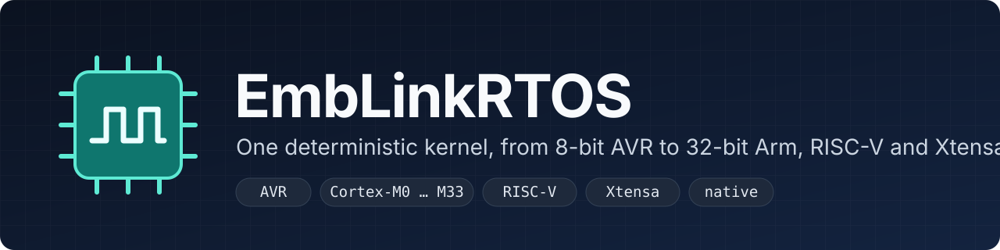
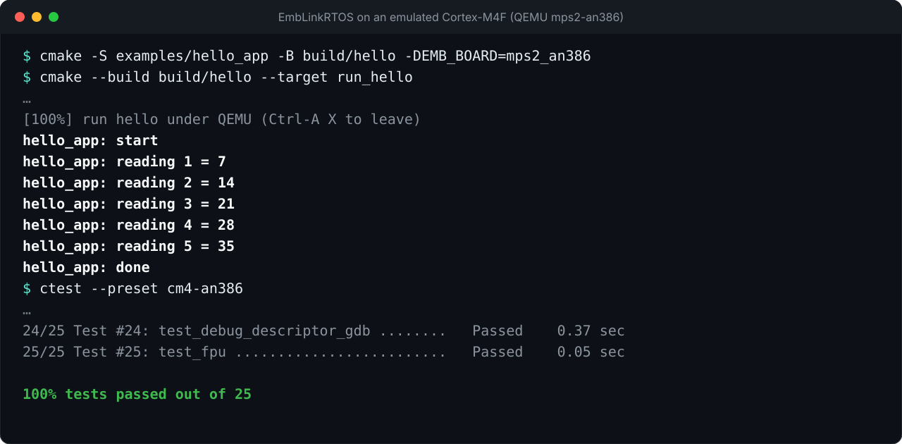
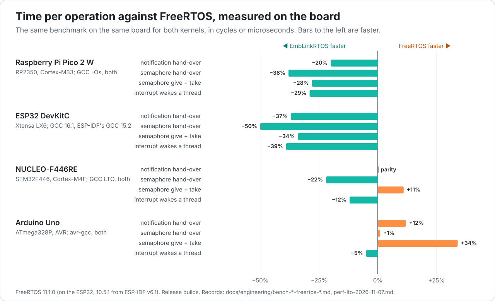

<p align="center">
  
</p>

<p align="center">
  <a href="https://github.com/EmbLinkOs/EmbLinkRTOS/actions/workflows/ci.yml"></a>
  <a href="https://emblinkos.github.io/EmbLinkRTOS/"></a>
  <a href="LICENSE"></a>
  <a href="docs/engineering/support-matrix.md"></a>
</p>

**EmbLinkRTOS is a real-time kernel for microcontrollers, written in C.** The same kernel source and the same semantics run on an 8-bit ATmega328P with 2 KB of RAM, on Cortex-M0 to M33, on RISC-V and on the ESP32. Every claim it makes comes with the evidence behind it: the test that checks it, the board it ran on, the build that produced it.

> **Status: 0.2.0, a preview.** The kernel is implemented and runs on hardware; the API may still change before 1.0. [Release notes](docs/engineering/release-0.2.0.md) · [What works today](docs/STATUS.md) · [Roadmap](docs/architecture/07-roadmap.md)

## Why EmbLinkRTOS

- **One kernel from 8-bit to 32-bit.** Threads, priorities, mutexes, queues and timers behave the same on an Arduino Uno and on a Cortex-M33. A smaller *tiny* profile fits the 8-bit parts.
- **Tested on real boards, in CI on emulators.** The conformance suites pass on four physical boards. CI runs them under QEMU and [EmbSIM](https://github.com/EmbLinkOs/EmbSIM) for nine more on every change ([support matrix](docs/engineering/support-matrix.md)).
- **Semantics you can check.** Fifteen specifications define the behaviour, and an executable reference model checks the kernel against them in CI ([differential testing](docs/engineering/differential-evidence.md)). Requirements are numbered, and the requirement matrix comes from executed tests.
- **Safe by default.** Checked builds catch API misuse and stack overflow, and record a crash record that survives the reset. A versioned debug descriptor lets GDB list the kernel's threads ([crash record](docs/engineering/crash-record.md), [debug descriptor](docs/engineering/debug-descriptor.md)).
- **No toolchain lock-in.** It builds with GCC, Clang and [EmbCC](https://github.com/EmbLinkOs/EmbCC), and Espressif's GCC and Clang for the ESP32.
- **Engineered like a product.** C with a MISRA-oriented coding standard; clang-tidy and cppcheck as merge gates; coverage that cannot regress; reproducible builds; an SPDX SBOM for any image.

## What the kernel provides

| | |
|---|---|
| **Threads** | Fixed-priority preemptive scheduling, optional round-robin time slicing, sleep and drift-free periodic wake-ups, suspend and resume |
| **Synchronization** | Semaphores; mutexes with priority inheritance, priority ceiling and recursion; event flags; condition variables |
| **Communication** | Copy-by-value message queues, direct-to-thread notifications |
| **Time** | Software timers (one-shot and periodic), deadlines, timeouts on every blocking call |
| **Deferred work** | Work queues, delayed work |
| **Interrupts** | Wake threads from ISRs, nested interrupt priorities, a separate interrupt stack |
| **Diagnostics** | Checked builds, stack guards, a crash record that survives the reset, an RTOS-aware debug descriptor |

The status page lists [what is implemented and what is not yet](docs/STATUS.md).

## Supported boards

| Tier | Boards |
|---|---|
| **Tested on hardware** | Arduino Uno (ATmega328P) · NUCLEO-F446RE (STM32F446, Cortex-M4F) · Raspberry Pi Pico 2 W (RP2350, Cortex-M33) · ESP32 DevKitC (Xtensa LX6) |
| **Tested in CI on an emulator** | BBC micro:bit (Cortex-M0) · Arm MPS2 AN385, AN386, AN500, AN505 (Cortex-M3, M4F, M7, M33) · RISC-V `virt` (RV32IMAC) · ESP32-C3 DevKitM-1 on EmbSIM · NUCLEO-F446ZE · native (Linux and macOS) |

A board's tier comes from archived runs, never from its own description ([support matrix](docs/engineering/support-matrix.md)). New boards are data, not code: a board is a short description generated into the build ([hardware descriptions](docs/engineering/hwgen.md)).

## Quick start

On Linux or macOS, with a C compiler, CMake 3.20+, Ninja and Python 3.10+:

```sh
git clone https://github.com/EmbLinkOs/EmbLinkRTOS.git && cd EmbLinkRTOS
python3 -m venv .venv && .venv/bin/pip install pyyaml
cmake --preset native-gcc -DPython3_EXECUTABLE=$PWD/.venv/bin/python3
cmake --build --preset native-gcc
ctest --preset native-gcc --output-on-failure
```

This builds the kernel for your computer and runs its conformance suites. To run the same suites on an emulated Cortex-M4F, install `arm-none-eabi-gcc` and QEMU, then use the `cm4-an386` preset instead. The [getting-started guide](docs/user/getting-started.md) covers every board, flashing real hardware, and building [your own application](docs/user/application.md).

## A first application

Two threads and a message queue: a producer sends a reading every 10 ms, without drift, and a consumer prints it ([`examples/hello_app`](examples/hello_app)).

```c
#include <emb/emb.h>
#include <emb_board.h>

typedef struct reading {
    uint32_t seq;
    uint32_t value;
} reading_t;

EMB_MSGQ_DEFINE(readings, sizeof(reading_t), 4u, 0u);

static void producer(void *arg)
{
    emb_instant_t next = emb_time_now();
    (void)arg;
    for (uint32_t seq = 1u;; seq++) {
        reading_t r = {seq, seq * 7u};
        next = emb_instant_add(next, EMB_MS(10));
        (void)emb_thread_sleep_until(next); /* every 10 ms, without drift */
        EMB_CHECK(emb_msgq_send(readings, &r, EMB_WAIT_FOREVER));
    }
}

static void consumer(void *arg)
{
    reading_t r;
    (void)arg;
    for (;;) {
        EMB_CHECK(emb_msgq_receive(readings, &r, EMB_WAIT_FOREVER));
        emb_board_puts("reading ");
        emb_board_put_u32(r.value);
        emb_board_puts("\n");
    }
}

EMB_THREAD_DEFINE(producer_thread, producer, NULL, 2u, 512u, 0u);
EMB_THREAD_DEFINE(consumer_thread, consumer, NULL, 3u, 512u, 0u);

int main(void)
{
    emb_board_init();
    emb_kernel_init();
    emb_kernel_start();
}
```

```sh
cmake -S examples/hello_app -B build/hello -DEMB_BOARD=mps2_an386
cmake --build build/hello --target run_hello   # runs under QEMU
```

<p align="center">
  
</p>

## Performance against FreeRTOS

The same benchmark on the same board for both kernels, measured on four boards:

<p align="center">
  
</p>

The results are reported as measured, including where EmbLinkRTOS is slower. Each figure links to its run, with the board, compiler, flags and configuration: [Pico 2 W](docs/engineering/bench-pico2w-freertos-2026-11-07.md) · [ESP32](docs/engineering/bench-esp32-freertos-2026-11-06.md) · [NUCLEO-F446RE](docs/engineering/perf-lto-2026-11-07.md) · [Arduino Uno](docs/engineering/bench-uno-freertos-2026-11-05.md).

## Documentation

- [User guide](docs/user/index.md): concepts, threads, synchronization, interrupts, configuration, debugging
- [API reference and full site](https://emblinkos.github.io/EmbLinkRTOS/)
- [Architecture](docs/architecture/) and [specifications](docs/specs/index.md): how the kernel is designed, and why
- [Project status](docs/STATUS.md): what is implemented, with its evidence
- [Hardware runs](docs/engineering/hil.md): every run on a physical board, archived

## Contributing

Contributions are welcome: board support, drivers, tests, documentation, and reviews of the specifications. Start with [CONTRIBUTING.md](CONTRIBUTING.md), and look for issues labelled [`good first issue`](https://github.com/EmbLinkOs/EmbLinkRTOS/labels/good%20first%20issue). Every commit carries a [Developer Certificate of Origin](DCO) sign-off (`git commit -s`); there is no CLA.

Questions, ideas and things you built go to [Discussions](https://github.com/EmbLinkOs/EmbLinkRTOS/discussions). Report security issues privately, as described in [SECURITY.md](SECURITY.md).

## The EmbLink family

- [EmbCC](https://github.com/EmbLinkOs/EmbCC): a C compiler and toolchain built from scratch, one of the compilers the kernel is tested with.
- [EmbSIM](https://github.com/EmbLinkOs/EmbSIM): a simulator of real microcontrollers and their circuits, which runs the kernel's suites for the Arduino Uno and the ESP32-C3 in CI.

## License

Apache-2.0. See [LICENSE](LICENSE) and [NOTICE](NOTICE).
