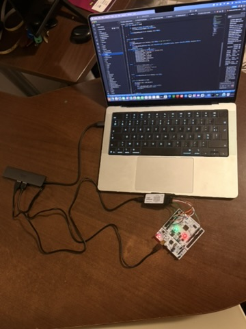
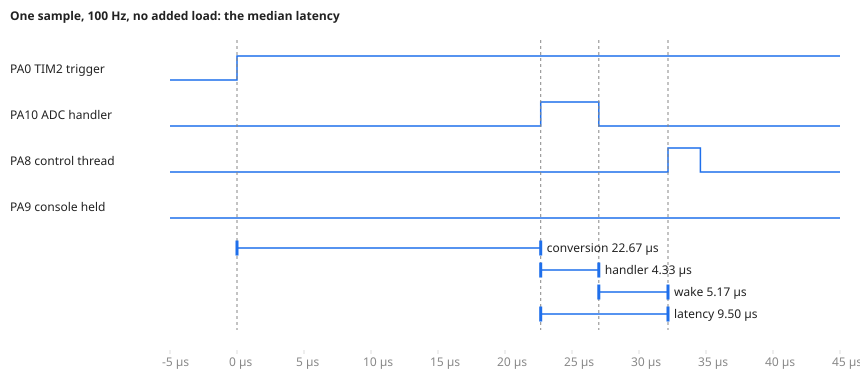
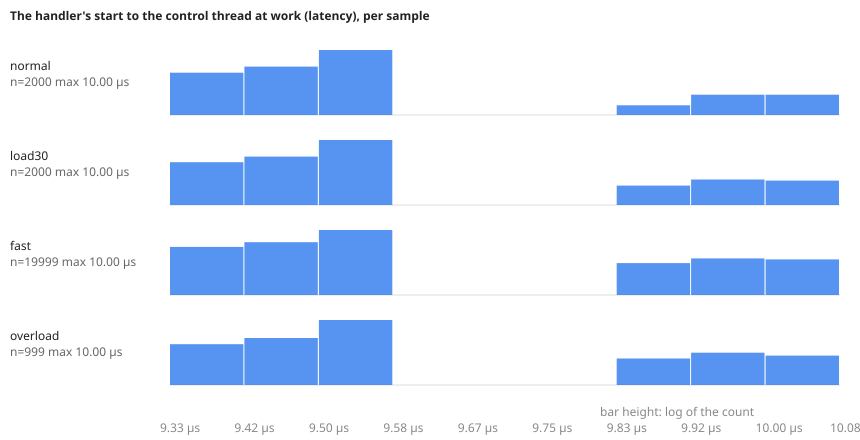

# The reference controller's timing, measured from outside (2026-11-07)

The [controller's run](controller-nucleo-2026-11-07.md) measured its latency with the core's cycle counter. Here a logic analyzer measured it from outside, on marker pins the controller drives, independently of the chip's clock.

From the ADC's interrupt to the control thread at work, the latency was **9.50 µs at the median and at most 10.0 µs**. That held over 24,998 processed samples in four scenarios, among them 1 kHz with half of each period busy and overload in degraded mode. Its standard deviation stayed between 57 and 113 ns.

**Board:** the NUCLEO-F446RE of the [controller's run](controller-nucleo-2026-11-07.md), at 180 MHz, ST-LINK firmware V2J49M36.

**Image:** `examples/controller` with its marker pins, GCC 14.2.1, configuration `f7a7de6f6a2ea8bd`, built from commit `27c11d6` on a clean tree (branch `feat/controller-timing`).

**Analyzer:** a 24 MHz, 8-channel USB analyzer of the Saleae Logic kind (Cypress FX2), recorded by sigrok-cli 0.7.2 (libsigrok 0.5.2, fx2lafw firmware).
- **Sample rate:** 12 MHz, one sample every 83.3 ns. That is the resolution of every figure here: a value is a whole number of samples.
- **Tool:** `tools/hil/controller_timing.py` set the controller's rate and load through its console, captured 20 s per scenario, and matched every sample's edges.

**Record:** the folder `docs/engineering/hil-runs/2026-11-07-nucleo_f446re-controller-timing`. Each scenario's capture is kept (`<scenario>.vcd.gz`, every edge of every channel). `timing.json` holds the statistics and `console.log` the controller's console during the captures. `controller_timing.py --from --out <folder>` recomputes the statistics and the images from the captures, without a board.



The bench during the captures. The analyzer (the small box at the centre) connects to the Mac by USB, and its leads go to the NUCLEO's morpho header. The NUCLEO connects through the hub by its ST-LINK's USB. The photo's resolution does not show which lead is on which pin. Each channel was identified from its signal instead: the trigger's 50 Hz square wave, the handler's 4.3 µs pulses 22.7 µs after it, the control thread's pulses after those, the console's 16 ms once a second, and the LED's toggling.

## The marker pins

| Analyzer | Pin | Driven by | Marks |
|---|---|---|---|
| D1 | PA0 (A0) | TIM2's channel 1, in hardware | each sampling trigger: the pin toggles at the update event that starts the conversion |
| D2 | PA10 (D2) | the ADC's handler | high from the handler's first statement to its last |
| D3 | PA8 (D7) | the control thread | high while it processes a sample |
| D4 | PA9 (D8) | `lock()`/`unlock()` | high while a thread holds the console |
| D5 | PA5 (D13) | the control thread | the LED, the simulated heater |

The software markers are each one BSRR write. On this board the console's pins (PA2, PA3) reach only the ST-LINK: the links to the headers, SB62 and SB63, are open from the factory, so the console's transmission was not captured. The PA9 marker shows when it happens.

## One sample



Each sample passes through these steps:
1. **The trigger.** TIM2's update event starts the conversion; the pin toggles at the same moment.
2. **Conversion, 22.67 µs.** The ADC samples the temperature sensor for 480 of its cycles and converts in 12, at 22.5 MHz: 21.9 µs. The rest is the interrupt's entry and the handler's first statement.
3. **Handler, 4.33 µs.** It reads the conversion, timestamps it, and sends it to the message queue. The send copies the sample to the waiting control thread and makes it ready.
4. **Wake, 5.17 µs.** From the handler's end, the kernel switches to the control thread. The thread returns from its receive, and reaches its marker.

## Results

Times in µs, as median / 99th percentile / maximum, over every sample of each 20 s capture:

| Scenario | Samples | Conversion | Handler | Wake | **Latency** | Latency std dev |
|---|---|---|---|---|---|---|
| 100 Hz, no added load | 2,000 | 22.67 / 22.67 / 22.75 | 4.33 / 4.42 / 4.50 | 5.17 / 5.17 / 5.58 | **9.50 / 9.58 / 10.00** | 57 ns |
| 100 Hz, 3 ms of work per sample | 2,000 | 22.67 / 22.75 / 22.75 | 4.33 / 4.42 / 4.50 | 5.17 / 5.50 / 5.58 | **9.50 / 9.92 / 10.00** | 73 ns |
| 1 kHz, 0.5 ms of work per sample | 19,999 | 22.67 / 22.67 / 22.75 | 4.33 / 4.42 / 4.50 | 5.17 / 5.50 / 5.58 | **9.50 / 9.92 / 10.00** | 82 ns |
| 100 Hz, 15 ms of work: degraded mode | 999 processed of 2,000 | 22.75 / 22.92 / 22.92 | 4.33 / 4.42 / 4.50 | 5.17 / 5.50 / 5.58 | **9.50 / 10.00 / 10.00** | 113 ns |

Processing took 2.42 µs without added load, 3,000.6 µs with 30%, 500.8 µs at 1 kHz with 50%, and 15,001.3 µs in the overload. The work is a busy wait for the period's share, so these confirm that the load is what was asked.



### The two clusters: the console

Every scenario's latency falls in two clusters, 9.33–9.58 µs and 9.83–10.00 µs, with nothing between them. The PA9 marker separates them. A sample whose interrupt arrived while a thread held the console was 0.42 µs later, at the median:

| Scenario | Console idle | Console held |
|---|---|---|
| 100 Hz, no added load | 9.50 µs (1,980 samples) | 9.92 µs (20) |
| 100 Hz, 3 ms of work | 9.50 µs (1,960) | 9.92 µs (40) |
| 1 kHz | 9.50 µs (19,459) | 9.92 µs (540) |
| degraded mode | 9.50 µs (940) | 9.92 µs (59) |

With the console idle, the interrupt arrives while the core idles. With it held, the interrupt preempts the telemetry or command thread in the middle of a print, and the kernel switches away from a preempted thread instead of the idle one. Where the 0.42 µs goes inside that switch is not measured here. The console is the shared peripheral of docs/adoption.md. The contention costs the control thread under half a microsecond and never delays it beyond 10 µs. The mutex is never waited on by the control thread, which does not print.

### The periods

| Scenario | Trigger period | Control thread start to start |
|---|---|---|
| 100 Hz | 10.000500 ms, std dev 28 ns | 10.000500 ms median, std dev 74 ns, within −0.42 / +0.58 µs |
| 1 kHz | 1.000083 ms, std dev 41 ns | 1.000083 ms median, std dev 46 ns, within −0.50 / +0.50 µs |
| degraded mode | 10.000500 ms, std dev 24 ns | 20.001000 ms median, every other sample, std dev 107 ns |

**The clocks:** the trigger's period is 50 ppm longer than nominal by the analyzer's clock. The board's clock comes from the ST-LINK's 8 MHz crystal, the analyzer's from its own. The two disagree by 50 ppm, and this measurement cannot say which is off.

**Jitter:** the trigger's jitter is that of the analyzer's own sampling, one sample (83 ns). The control thread starts within half a microsecond of its period, at 100 Hz and at 1 kHz.

### Degraded mode

In the overload, the controller processed 999 samples and shed 1,001, every other one. Shedding is a deadline decision, not a delay: each processed sample started 9.50 µs after its interrupt (99th percentile 10.0 µs), the same as without load. The handler is shorter, down to 3.71 µs, when the control thread is still busy with the previous sample. Then the send only copies into the queue, with no thread to wake.

## Against the cycle counter

The controller's own telemetry gave `lat_max_us=9` throughout. It measures from the handler's timestamp, taken after `emb_stm32f4_adc_take()`, to the control thread's start, truncated to whole microseconds. The analyzer measures from the handler's first statement, so its 9.50–10.0 µs adds the read of the conversion. The two agree.

## Not shown here

- **Build:** the image is the controller's checked build (the default), without `EMB_LTO`. The [LTO measurements](perf-lto-2026-11-07.md) suggest a release build with LTO would be faster.
- **Interrupt entry:** the time from the conversion's end to the handler's first statement is inside the 22.67 µs. The ADC gives no edge at the end of its conversion, so it cannot be separated here. An external interrupt from a pin would measure it, and needs the EXTI driver.
- **Transitions:** each 20 s capture began 4 s after its rate and load were set. Changing the rate before the load gave 2 deadline misses in the controller's counters during the change from 100 Hz with 3 ms of work to 1 kHz, before `load 50` arrived. The captures do not include them.
- **One board, one analyzer, one evening.**

## Reproducing it

```sh
cmake -S examples/controller -B build/controller -G Ninja -DEMB_BOARD=nucleo_f446re
cmake --build build/controller
openocd -f board/st_nucleo_f4.cfg -c "program build/controller/controller.elf verify reset exit"
# analyzer D1..D5 on PA0, PA10, PA8, PA9, PA5, and GND; sigrok-cli installed
python3 tools/hil/controller_timing.py --port /dev/cu.usbmodem* --out <record directory>
```
